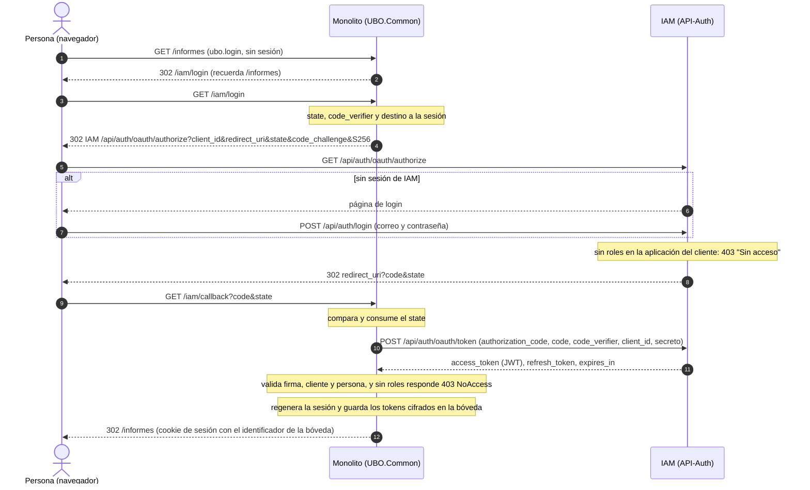
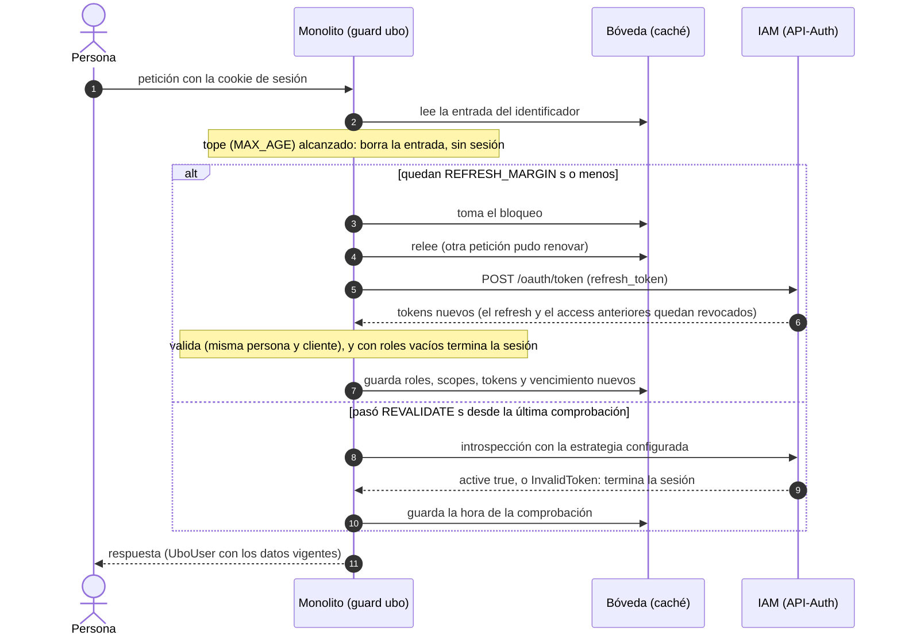
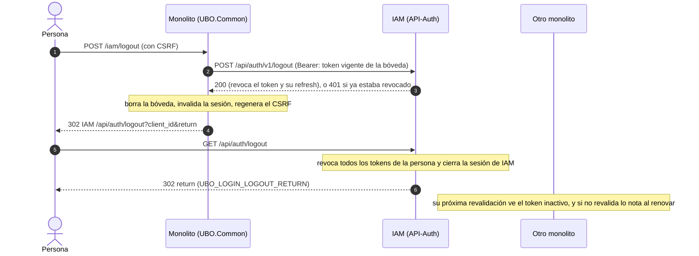

# Inicio de sesión único (SSO) de la UBO, de punta a punta

Este documento explica cómo una persona entra a un **monolito Laravel** con su cuenta de la UBO, quién hace qué en
cada paso y cómo operarlo. Hay tres actores:

- **IAM** es **API-Auth**: guarda las cuentas, es el único lugar donde se escribe la contraseña y emite los
  tokens. Su código está en el repositorio `API-Auth`.
- **UBO.Common** (esta librería) es el lado del monolito: el módulo [Login](modules/login.md) maneja el flujo, la
  sesión y la autorización, y el módulo [Auth](modules/auth.md) habla con IAM y valida tokens.
- **La aplicación monolito** es tu sistema: pone las rutas protegidas, decide cómo mostrar los errores y configura
  el entorno.

Referencias: la configuración y el detalle de cada pieza están en [docs/modules/login.md](modules/login.md); los
comportamientos exigidos, en `openspec/specs/login-*` y `openspec/specs/auth-user-token`.

> Lo que dice este documento sobre IAM está leído de su código y README. Los hechos marcados como **verificado**
> (sección 5) se probaron contra un IAM local real.

## 1. Vista general

```
                     ┌───────────────────────────── IAM (API-Auth) ─────────────────────────────┐
 Navegador ─────────►│ /api/auth/login   (contraseña)     /api/auth/oauth/authorize (PKCE)      │
                     │ /api/auth/logout  (central)        sesión de IAM (cookie, 120 min)       │
                     └──────────────────────────────────────────────────────────────────────────┘
 Monolito ──servidor a servidor──► /api/auth/oauth/token · /api/auth/v1/logout · v1/public-key · v1/introspect
   │
   ├─ Login:  rutas /iam/*, guard "ubo", UboUser, ubo.login / ubo.role, Gate por scopes, bóveda de tokens
   └─ Auth:   UserTokenClient (canje, renovación, revocación), LocalTokenValidator, TokenValidator
```

La contraseña **solo** viaja a IAM. El monolito nunca la ve: recibe un código de un solo uso y lo canjea por tokens.
Esos tokens (acceso y refresh) quedan en el servidor, cifrados; el navegador solo tiene la cookie de sesión de Laravel
con un identificador aleatorio.

## 2. Qué hace cada uno

| Paso o responsabilidad | IAM (API-Auth) | UBO.Common | La aplicación monolito |
|---|---|---|---|
| Contraseña y cuentas | Las guarda y las pide (`/api/auth/login`, 10 intentos por minuto por correo e IP) | No las ve | — |
| Alta de la aplicación, el cliente y los roles | Comandos `oauth:application`, `oauth:client`, `oauth:role`, `oauth:assign-role` | — | Alguien las ejecuta una vez y guarda el `client id` y el secreto |
| Empezar el login | Atiende `GET /api/auth/oauth/authorize`: exige PKCE `S256`, no pide consentimiento, rechaza con "Sin acceso" (403) a quien no tiene ningún rol en la aplicación del cliente | `GET /iam/login`: crea `state` y verificador PKCE, los guarda en la sesión y redirige | Enlaza a `/iam/login` o deja que `ubo.login` lo haga |
| Sesión de IAM | La abre al escribir la contraseña (cookie `HttpOnly`, `SameSite=Lax`, acotada a `/api/auth`, 120 minutos sin uso) y la reutiliza: un segundo monolito no vuelve a pedir la clave | — | — |
| Volver con el código | Redirige a la `redirect_uri` registrada con `code` y `state` | `GET /iam/callback`: valida y consume el `state` (un solo uso, vence a los 600 s), canjea el código con el verificador | Decide cómo mostrar `LoginFailed` y `NoAccess` |
| Emitir el token | Firma un JWT con `sub` (id de la persona), `scopes`, `roles` y `aud` (ver sección 3.3) | Lo valida con la clave pública (firma y vigencia), que sea del cliente de login y de una persona, y que traiga algún rol | — |
| Sesión del monolito | — | Regenera el id de sesión y el token CSRF, guarda los tokens cifrados en la bóveda y en la sesión solo el identificador | Configura una sesión de servidor y un caché compartido |
| Quién es la persona | — | Guard `ubo`, `UboUser` (id, roles, scopes, audiencias, `expiresAt`), `Auth::guard('ubo')->user()` | Lo usa en controladores y vistas |
| Proteger rutas | — | `ubo.login` (sin sesión: redirige al login o 401 JSON), `ubo.role:a,b` (403 si no tiene ninguno) | Pone los middleware en sus rutas |
| Autorización fina | Decide qué scopes tiene cada rol | `Gate::before`: un scope del token es una habilidad (`@can('geografia:leer')`, `can:`); nunca niega | Define políticas y `Gate::define` para el resto |
| Mantener el token vivo | `grant_type=refresh_token`: un solo uso, recalcula `roles`, solo descarta scopes | Renueva `UBO_LOGIN_REFRESH_MARGIN` s antes de vencer, una vez aunque lleguen peticiones en paralelo | — |
| Enterarse de un logout ajeno | Revoca los tokens; responde `active:false` en `introspect` | Revalida cada `UBO_LOGIN_REVALIDATE` s (solo `introspection`/`hybrid` con credenciales M2M) | Configura las credenciales M2M si lo quiere |
| Tope de la sesión | No tiene (cada renovación suma 120 minutos) | `UBO_LOGIN_MAX_AGE`: 12 h desde el login | — |
| Cerrar sesión | `POST /api/auth/v1/logout` (revoca el token y su refresh) y `GET /api/auth/logout` (cierra la sesión de IAM y revoca todos los tokens de la persona) | `POST /iam/logout`: revoca el token vigente, borra la bóveda, invalida la sesión y manda a IAM | Pone un formulario con `@csrf` |
| Probar sin IAM | — | `UboLogin::actingAs()` (falla en producción) | Lo usa en sus tests |

## 3. IAM en detalle

### 3.1 Login central y su sesión

- **Página de login**: `GET/POST /api/auth/login` (HTML dentro de API-Auth). Al escribir la clave IAM abre su
  sesión y vuelve a lo que la persona intentaba abrir (el `authorize`).
- **Sesión de IAM**: `SESSION_LIFETIME` (120 minutos sin uso), cookie `HttpOnly`, `SameSite=Lax` y con ruta
  `/api/auth`. Es lo que hace el "único": si la persona ya tiene sesión, `authorize` responde de inmediato con el
  código y no ve ninguna pantalla. Las renovaciones con el refresh token **no** tocan esta sesión: un monolito
  puede renovar durante horas mientras la sesión de IAM ya venció, y la próxima vez que la persona pase por IAM
  tendrá que escribir la clave.
- **`prompt=login`** (`UBO_LOGIN_PROMPT=login` o `?reauth=1` en `/iam/login`): cierra la sesión de IAM completa y
  vuelve a pedir la clave. Los tokens de los otros sistemas siguen hasta que venzan.

### 3.2 Endpoints que usa el monolito

| Endpoint | Quién lo llama | Qué hace |
|---|---|---|
| `GET /api/auth/oauth/authorize` | El **navegador** (por `UBO_LOGIN_PUBLIC_URL`) | Authorization Code. Sin `code_challenge` o con método distinto de `S256`: 400 antes de pedir la clave. Una `redirect_uri` no registrada: error, sin redirigir. Sin roles en la aplicación: 403 "Sin acceso" |
| `POST /api/auth/oauth/token` | El **servidor** (por `UBO_AUTH_URL`) | `authorization_code` (con `code_verifier`), `refresh_token` y `client_credentials`. Límite de **120 por minuto por `client_id`** (`OAUTH_TOKEN_RATE_LIMIT`): 429 con `Retry-After`. Errores en formato OAuth2 (`error`, `error_description`, `hint`) |
| `POST /api/auth/v1/logout` | El servidor, con el token como Bearer | Revoca ese access token y su refresh token. Con un token ya revocado o vencido responde 401 |
| `GET /api/auth/logout?client_id=…&return=…` | El **navegador** | Logout central: revoca todos los tokens de la persona (de todos los sistemas) y cierra la sesión de IAM. Vuelve a `return` solo si su origen es el de una `redirect_uri` registrada del cliente; si no, muestra "Sesión cerrada". Es una página `GET`, no una API |
| `GET /api/auth/v1/public-key` | El servidor (Auth) | Clave pública PEM con la que se verifica la firma sin llamar a IAM |
| `POST /api/auth/v1/introspect` | El servidor, con token M2M con scope `introspect` | `{active, sub, client_id, scope, aud, roles, exp, user}`; `{active:false}` si el token no es válido o fue revocado |

El código de autorización y los tokens los maneja Passport; los endpoints `approve`, `deny` y `device` están
apagados.

### 3.3 Qué lleva el token

Un JWT firmado (RS256) con:

| Claim | Valor |
|---|---|
| `sub` | Id de la persona en IAM (`UboUser::getAuthIdentifier()`). En un token de sistema es el client id |
| `aud` | El client id del cliente de login **primero** y después, en orden alfabético, las aplicaciones dueñas de los scopes (`["<client id>", "api-maestros"]`) |
| `scopes` | Los scopes que conceden los roles de la persona **en la aplicación del cliente**. Sin `scope` en el pedido, todos |
| `roles` | Los nombres de esos roles |
| `exp`, `jti` | Vencimiento (`PASSPORT_ACCESS_TOKEN_TTL`) e identificador |

Un token de usuario no trae más que lo de la aplicación del cliente: los roles que la persona tenga en otras
aplicaciones no aparecen.

### 3.4 Tiempos (en minutos, variables de IAM)

| Variable de IAM | Por defecto | Qué es |
|---|---|---|
| `PASSPORT_ACCESS_TOKEN_TTL` | 60 | Vida del token de acceso |
| `PASSPORT_REFRESH_TOKEN_TTL` | 120 | Vida del refresh token: es un plazo de **inactividad**, porque cada renovación entrega uno nuevo |
| `PASSPORT_CLIENT_TOKEN_TTL` | 60 | Vida de los tokens de sistema (`client_credentials`) |
| `SESSION_LIFETIME` | 120 | Sesión web de IAM (sin uso) |
| `OAUTH_TOKEN_RATE_LIMIT` | 120 | Solicitudes por minuto a `/oauth/token` por cliente |

`UBO_LOGIN_REFRESH_TTL` (7200 s) del monolito debe ser coherente con `PASSPORT_REFRESH_TOKEN_TTL` (120 min): la
bóveda no debería guardar un refresh token que IAM ya venció.

### 3.5 Comandos de alta

Se ejecutan en el repositorio de API-Auth, una vez por sistema (el detalle está en su README):

```bash
php artisan oauth:application portal "Portal de la UBO"
php artisan oauth:client portal-web --application=portal --type=authorization-code --redirect=https://portal.ubo.cl/iam/callback
php artisan oauth:role coordinador "Coordina el portal" --application=portal
php artisan oauth:assign-role ana@ubo.cl portal/coordinador
```

- `oauth:application` crea la aplicación (el sistema, con sus roles y scopes).
- `oauth:client … --type=authorization-code --redirect=…` crea el cliente **confidencial** del login y muestra su
  `client id` y secreto **una sola vez**. La `--redirect` se repite si hay varias y debe ser exactamente la
  `redirect_uri` del monolito.
- `oauth:role` crea un rol de la aplicación y `oauth:assign-role <correo> <aplicación>/<rol>` se lo da a una
  persona (agrega sin quitar los demás; con `--sync` reemplaza los que tiene en esa aplicación). Los scopes de cada
  rol se asignan con `oauth:scope … --role=<aplicación>/<rol>`. **Una persona sin ningún rol en la aplicación no
  entra**.

## 4. Qué hace UBO.Common

### 4.1 Módulo Login

- **Rutas** (grupo `web`, prefijo `iam`, `UBO_LOGIN_ROUTE_PREFIX`): `GET /iam/login`, `GET /iam/callback`,
  `POST /iam/logout`.
- **PKCE y `state`**: el verificador son 32 bytes aleatorios y el `code_challenge` su SHA-256 en base64url; el
  `state` es aleatorio, se lee una sola vez y vence a los 600 s. La `redirect_uri` sale de `APP_URL` (o de
  `UBO_LOGIN_REDIRECT_URI`), nunca de la cabecera `Host`.
- **Guard `ubo` y `UboUser`**: el guard existe sin tocar `config/auth.php`. `UboUser` guarda id, `clientId`, roles,
  scopes, audiencias y vencimiento, y **no guarda tokens**.
- **Middleware**: `ubo.login` y `ubo.role:a,b` (nombres de rol sensibles a mayúsculas). Dentro de la ruta, `ubo`
  pasa a ser el guard por defecto.
- **Gate por scopes**: `Gate::before` concede las habilidades que son scopes de la persona y deja el resto a las
  políticas de la aplicación.
- **Bóveda** (`TokenVault`): los tokens y los datos de la persona, como JSON cifrado con `APP_KEY`, en el
  almacén `UBO_LOGIN_STORE`, bajo la clave `ubo-login:vault:<sha256 del identificador>`. La sesión de Laravel solo
  guarda el identificador (40 caracteres). Hay **una sola copia**, escrita bajo `Cache::lock`, porque IAM rota el
  refresh token y revoca el access token anterior al renovar.
- **Renovación**: si al token le quedan `UBO_LOGIN_REFRESH_MARGIN` s (60) o menos, el guard lo renueva bajo el
  bloqueo (10 s de vida, espera 5 s) y las demás peticiones usan el resultado. El token nuevo se valida como el del
  login, debe ser de la misma persona y del mismo cliente, y reemplaza roles, scopes y audiencias.
- **Revalidación**: cada `UBO_LOGIN_REVALIDATE` s (300) pregunta a IAM con la estrategia de `UBO_AUTH_STRATEGY` si el
  token sigue activo. Solo con `introspection` o `hybrid` y con `UBO_AUTH_CLIENT_ID`/`UBO_AUTH_CLIENT_SECRET`. Con
  `hybrid` y `UBO_AUTH_DEGRADED_MODE=true`, una caída de la introspección se acepta y la revocación pasa inadvertida.
  La introspección tiene su propia caché (`UBO_AUTH_INTROSPECTION_TTL`, 30 s por defecto), así que el aviso puede
  tardar un poco más.
- **Tope**: `UBO_LOGIN_MAX_AGE` (43200 s) desde el login, por mucho que se renueve; `0` lo apaga.
- **Logout**: revoca el token **vigente de la bóveda** (el ya renovado), borra la entrada, invalida la sesión y
  manda a `GET /api/auth/logout` de IAM. Con `scope=local` no pasa por IAM.
- **`UboLogin::actingAs()`**: deja a una persona en la bóveda, sin refresh token y marcada como simulada: no se
  renueva ni se revalida.

### 4.2 Módulo Auth (lo que usa el login)

- **`Contracts\UserTokenClient`**: `exchangeCode()`, `refresh()` y `revoke()`. Usa los timeouts, la traza
  (`traceparent`) y el circuito de las demás llamadas a IAM. `UserTokenRejected` si IAM rechaza (`status`, `error`);
  `AuthServerUnavailable` si no responde (503). Un 429 no abre el circuito.
- **`Contracts\LocalTokenValidator`**: firma y vigencia con la clave pública, sin importar `UBO_AUTH_STRATEGY`. Es
  lo que valida el token recién entregado.
- **`Contracts\TokenValidator`**: el validador de la estrategia configurada. El login lo usa solo para revalidar.

## 5. Secuencias

### 5.1 Login



### 5.2 Renovación y revalidación (en cada petición, dentro del guard)



Si IAM no responde en la renovación o la revalidación, la petición sigue con el token vigente y vuelve a intentar en
la siguiente (ver sección 7).

### 5.3 Logout



### 5.4 Hechos verificados contra un IAM real

Probados con un API-Auth local y el cliente de código de autorización:

| Hecho | Consecuencia en el módulo |
|---|---|
| El refresh token es de **un solo uso**: reusarlo da `400 invalid_grant` | Los tokens deben tener una sola copia y renovarse bajo bloqueo; el `invalid_grant` solo termina la sesión si ninguna otra petición renovó |
| Renovar **revoca al instante** el access token anterior | Una petición en vuelo con el token viejo recibe 401; el logout y las llamadas deben usar el token de la bóveda, no el del login |
| Al renovar, `roles` se recalcula y los scopes **solo se descartan** | Los roles que IAM quita o agrega se notan en la renovación; los scopes de un rol nuevo llegan en el siguiente login |
| `POST /api/auth/v1/logout` revoca el token **y su refresh token**; un segundo intento da **401** | El 401 se trata como éxito |
| `/oauth/token` limita a **120 por minuto por cliente** (429 con `Retry-After`) | Es un tope compartido por todas las personas del monolito; el 429 no abre el circuito ni termina la sesión (hay 60 s de margen) |

## 6. Operación

### 6.1 En IAM

1. Crear la aplicación, los roles y los scopes del monolito, y dar un rol a cada persona (sección 3.5).
2. Crear el cliente `authorization-code` con la `--redirect` exacta del callback y guardar el `client id` y el
   secreto.
3. Opcional: un cliente `client-credentials` con el scope `introspect` si se quiere la revalidación (el monolito lo
   usa como `UBO_AUTH_CLIENT_ID`/`UBO_AUTH_CLIENT_SECRET`). Sin él el login funciona igual.
4. En producción, `SESSION_SECURE_COOKIE=true`, `TRUSTED_PROXIES` correcto (el límite por cliente no depende de la IP,
   pero el de `/api/auth/login` sí) y `PASSPORT_REFRESH_TOKEN_TTL=120`.

### 6.2 En el monolito

```dotenv
UBO_COMMON_LOGIN=true
UBO_AUTH_URL=http://api-auth                    # interna, de servidor a servidor
UBO_LOGIN_PUBLIC_URL=https://iam.ubo.cl         # pública, la que abre el navegador
UBO_LOGIN_CLIENT_ID=<client id del cliente de login>
UBO_LOGIN_CLIENT_SECRET=<secreto>
APP_URL=https://portal.ubo.cl
APP_KEY=<la misma en todos los servidores>
SESSION_DRIVER=redis                            # de servidor: database, redis, file... nunca cookie
UBO_LOGIN_STORE=redis                           # compartido y con bloqueos
```

Las demás variables (`UBO_LOGIN_*`) y sus valores por defecto están en [docs/modules/login.md](modules/login.md).

### 6.3 Caché, sesión y `APP_KEY`

- **Almacén de la bóveda** (`UBO_LOGIN_STORE`, por defecto el de la aplicación): debe estar **compartido por todos los
  servidores** y soportar **bloqueos** (`redis` o `database`). Con `array` cada petición pierde la sesión; con `file`
  solo sirve con un servidor. Sin bloqueos la renovación igual funciona, pero dos peticiones simultáneas podrían
  renovar a la vez (la segunda recibe `invalid_grant` y se resuelve releyendo la bóveda).
- **`APP_KEY` igual en todos los servidores**: la bóveda va cifrada con ella. Con una clave distinta, la entrada es
  ilegible, se descarta y la persona vuelve a pasar por IAM.
- **Sesión de servidor** (`SESSION_DRIVER` distinto de `cookie`; con `cookie` el módulo se niega), con
  `SESSION_SAME_SITE=lax`.
- Vaciar la caché cierra todas las sesiones del login (las personas vuelven por IAM, transparente si su sesión de IAM
  sigue abierta).
- Una caída de la caché al guardar un token renovado deja el refresh token gastado: la persona vuelve a pasar por IAM y
  queda un `warning`.

### 6.4 Cuándo termina la sesión de una persona

Resumen (el detalle y las excepciones están en la sección 5 de [login.md](modules/login.md)):

- IAM rechaza el refresh token (`invalid_grant`) y nadie lo renovó antes.
- El token renovado no trae roles, es de otra persona o cliente, o no se puede validar.
- El token vence y no hay refresh token.
- Pasan `UBO_LOGIN_MAX_AGE` segundos desde el login (12 h por defecto).
- La revalidación encuentra el token inactivo (logout en otro sistema).
- La entrada de la bóveda ya no existe (caché vaciada, vencida o `APP_KEY` distinta).
- Una sesión en IAM vencida no termina la del monolito, pero el próximo paso por IAM pedirá la clave.

### 6.5 Qué se ve cuando IAM cae

| Situación | Efecto |
|---|---|
| Persona con el token vigente, IAM no responde a la renovación (conexión, circuito abierto, 5xx) o la rechaza por otro motivo (429) | Sigue autenticada hasta que el token venza. IAM recibe una sola llamada por petición. Queda un `warning` solo en los rechazos (4xx) |
| Token ya vencido, IAM no responde | El guard devuelve `null` **sin borrar la bóveda**: la persona va al login. Cuando IAM vuelve, la siguiente petición renueva |
| Revalidación sin respuesta | La persona sigue; se reintenta en la siguiente petición |
| Persona sin sesión, IAM caído | No puede entrar: si IAM no responde al navegador, el error es el de su proxy; si el navegador llega pero el servidor no, el callback responde 503 (`AuthServerUnavailable`) |
| Logout con IAM caído | La revocación falla, queda un `warning`, se borra la bóveda y se cierra la sesión local; el token expira solo |
| Descarga de la clave pública | Se guarda en caché 24 h (`UBO_AUTH_PUBLIC_KEY` la fija): una caída breve no afecta |

### 6.6 Diagnóstico

Para revisar la configuración y la conexión con IAM desde el monolito:

```bash
php artisan ubo:auth:check
```

| Síntoma | Causa probable | Qué hacer |
|---|---|---|
| IAM responde un error de `redirect_uri` | La `redirect_uri` enviada no es exactamente la registrada | Revisar `APP_URL` y `UBO_LOGIN_REDIRECT_URI` contra la `--redirect` del cliente |
| `LoginFailed` 400 "the state does not match", "no login was started" o "it took too long" | La sesión no se conservó entre el login y el callback, o tardó más de `UBO_LOGIN_STATE_TTL` | `SESSION_SAME_SITE=lax`, sesión de servidor compartida, mismo dominio en `APP_URL` |
| `LoginFailed` 400 `invalid_grant` al canjear | Código usado, verificador distinto o `redirect_uri` distinta en el canje | Que el callback no se abra dos veces; mismo `redirect_uri` en las dos llamadas |
| `LoginFailed` 400 `invalid_client` | Secreto equivocado | Revisar `UBO_LOGIN_CLIENT_SECRET` |
| `NoAccess` 403 (o "Sin acceso" en IAM) | La persona no tiene ningún rol en la aplicación del cliente | `oauth:assign-role correo aplicación/rol` |
| `LoginFailed` 400 "it was issued to another client" / "not issued to a person" | Cliente de login o credenciales mezcladas con las M2M | Usar el cliente `authorization-code` para `UBO_LOGIN_CLIENT_*` |
| `LogicException` con `SESSION_DRIVER=cookie` | La sesión viajaría en el navegador | Usar `database`, `redis` o `file` |
| `LoginNotConfigured` | Falta una variable al usar las rutas | La excepción nombra la variable |
| La persona vuelve a IAM a cada rato o "se cae" la sesión en un servidor | Caché de la bóveda no compartida (`array`, `file` con varios servidores), `APP_KEY` distinta, caché vaciada o `UBO_LOGIN_REFRESH_TTL` corto | Revisar `UBO_LOGIN_STORE` y `APP_KEY` |
| La sesión termina a las 12 horas | Es el tope `UBO_LOGIN_MAX_AGE` | Subirlo o `0` |
| La sesión termina a la hora y poco | Sin refresh token (el cliente no lo entrega) o IAM rechazó el refresh | Mirar los `warning` del log |
| Un logout en otro sistema no se nota | `UBO_AUTH_STRATEGY=jwt`, o no hay credenciales M2M, o `UBO_LOGIN_REVALIDATE=0` | Se nota al renovar (hasta ~1 hora); para revalidar, usar `hybrid` o `introspection` con credenciales M2M |
| 429 al canjear o renovar | Más de 120 solicitudes por minuto del cliente en IAM | Es un tope por cliente, compartido por todo el monolito; en una renovación no termina la sesión |

Mensajes del log (`warning`) que dejan los casos que no se ven en pantalla:

- `UBO.Common could not renew the access token of a login: …`: IAM rechazó una renovación por un motivo que no es
  `invalid_grant`.
- `UBO.Common ended a login because the renewed access token could not be validated: …` o `… is of another person or client`.
- `UBO.Common could not save the renewed tokens of a login: …`: falló la caché al guardar.
- `UBO.Common could not revoke the access token at logout: …`: IAM no respondió al revocar.

## 7. Límites conocidos

- **El logout central depende de la sesión de IAM**: `GET /api/auth/logout` revoca los tokens de la persona que tiene
  la cookie de IAM. Si esa sesión ya venció (120 minutos sin uso en IAM, aunque el monolito siga renovando), solo
  se revoca el token del monolito que hizo el logout.
- **`GET /api/auth/logout` es una página `GET` que cierra sesión**: cualquier enlace puede cerrar la sesión de IAM de
  quien lo abra. Es una decisión de API-Auth, no del módulo.
- **El tope de 12 h es del monolito**: IAM no limita la duración total de una cadena de renovaciones.
- **Roles, sí; scopes, no**: un rol nuevo se nota al renovar, pero sus scopes llegan en el siguiente login.
- Los clientes públicos, las SPA y CORS no están soportados.
